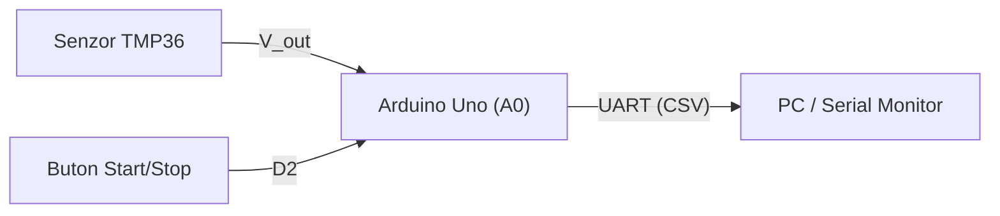

# APD - Laborator

Proiect de laborator pentru disciplina Achiziția și prelucrarea datelor.
Nod de achiziție a temperaturii bazat pe Arduino Uno.

## Autor
Cîrstoc Darius Ionuț - Grupa TI

## Hardware
Arduino Uno R3, senzor de temperatură TMP36

## Note
Parolele și cheile de acces nu se stochează în git pentru a preveni scurgerile de securitate.

## Parametri de sistem
- Perioada de eșantionare: 500 ms
- Status LED: GPIO 2

## Senzori utilizați
| Senzor | Interfață | Domeniu |
|---|---|---|
| TMP36 | Analogic (A0) | -40°C +125°C |s

## Notițe Proiect
- Frecvența de eșantionare recomandată este de 100 ms.
- Toate datele citite vor fi salvate local înainte de procesare.


# Sistem de achiziție și monitorizare a temperaturii (APD)

Proiect de laborator pentru achiziția semnalelor analogice, filtrarea numerică și transmiterea datelor pe interfața serială UART.

[Specificația protocolului](docs/protocol.md)

## 1. Arhitectura sistemului



## 2. Alocarea pinilor (Pinout)

| Componentă | Pin Arduino | Configurație | Rol |
| :--- | :---: | :---: | :--- |
| Senzor TMP36 | `A0` | Intrare analogică | Măsurare temperatură |
| Buton control | `D2` | `INPUT_PULLUP` | Activare / oprire eșantionare |
| LED Stare | `D13` | `OUTPUT` | Semnalizare achiziție activă |

## 3. Relația de conversie

Pentru senzorul TMP36 ($500\text{ mV}$ offset la $0^\circ\text{C}$, pantă $10\text{ mV}/^\circ\text{C}$), temperatura în grade Celsius se calculează cu relația:

$$T(^\circ\text{C}) = \left(\frac{D_{ADC} \cdot 5.0}{1023.0} - 0.5 \right) \cdot 100$$

## 4. Filtrarea numerică

Medierea aritmetică pentru $M$ eșantioane este definită prin ecuația:

$$y[n] = \frac{1}{M} \sum_{k=0}^{M-1} x[n-k]$$

Implementare în C++ pentru calculul mediei mobile:

```cpp
#define M 8

float calculate_moving_average(float samples[]) {
    float sum = 0.0f;
    for (int k = 0; k < M; k++) {
        sum += samples[k];
    }
    return sum / M;
}
```

## 5. Formatul datelor transmise (CSV)

```text
timestamp_ms, raw_adc, voltage_v, temp_c
1000, 153, 0.75, 24.78
2000, 155, 0.76, 25.76
```

## 6. Checklist verificare

- [x] Configurare repository și .gitignore
- [x] Redactare specificație hardware în Markdown
- [ ] Simulare circuit în Tinkercad Circuits
