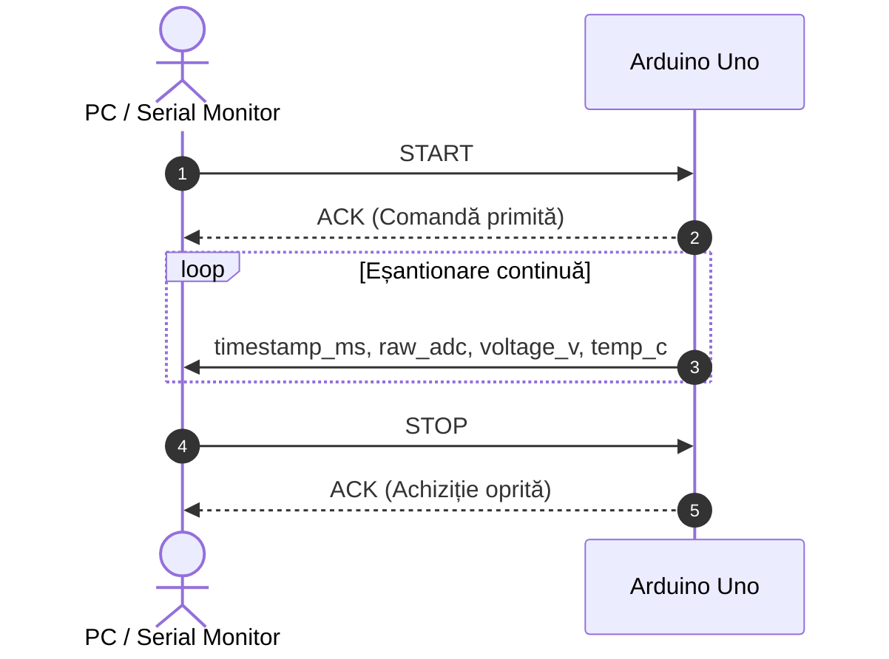
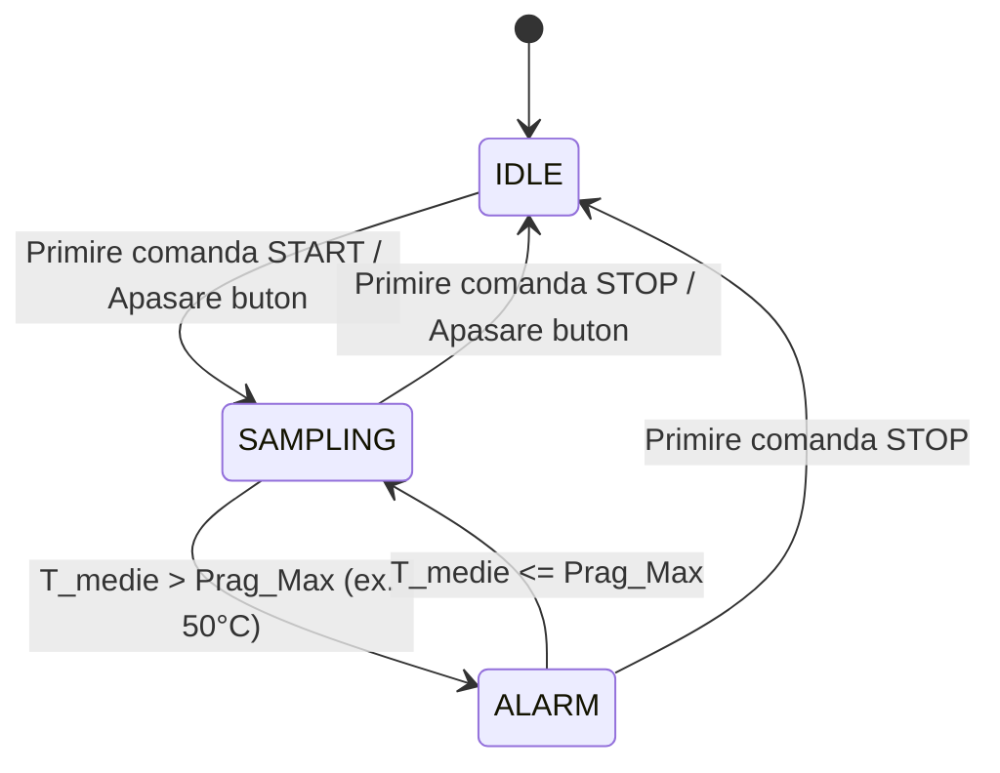

# Protocolul de Comunicație UART

Documentația detaliată a schimbului de mesaje pe portul serial între PC (gazdă) și plăcuța Arduino.

## 1. Diagramă de secvență și schimb de mesaje

## 2. Setul de comenzi suportate

| Comandă | Cod ASCII | Efect produs |
| :--- | :---: | :--- |
| `START` | `0x01` | Inițiază achiziția și transmiterea datelor la intervale fixe |
| `STOP`  | `0x02` | Oprește transmiterea cadrelor pe interfața serială |
| `STATUS`| `0x03` | Returnează starea curentă a sistemului și numărul de eșantioane |

## 3. Automatul de stări al sistemului

